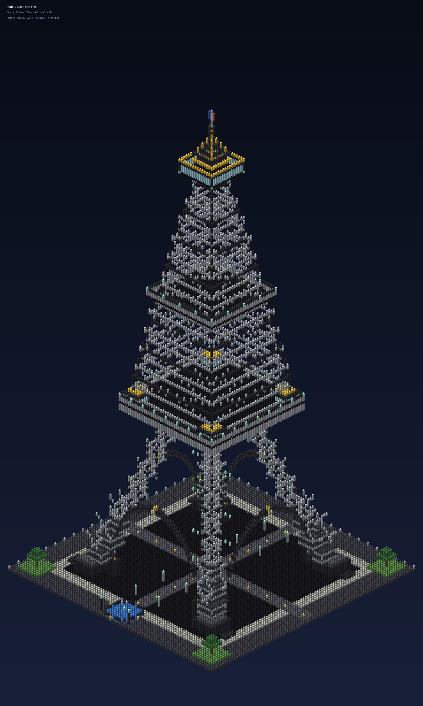

# 埃菲尔铁塔 · 631 / 黄金比例版



- 中心 `(300,0,300)`，基座 64×64，结构高 192，旗顶 199
- **24,004 方块**（BDX 压缩后约 5.5 KB）
- 60% 基座 / 30% 塔身 / 10% 塔冠
- 黄金分割：第一平台 `y=73`、第二平台 `y=119`、塔冠 `y=173`
- 深色 60 / 铁栏 30 / 金灯 10；焦点在塔冠，基座大拱是第二焦点
- StartPos `256 0 256`；观看 `tp @s 300 70 380 facing 300 95 300`

## 文件

| 文件 | 说明 |
|---|---|
| `design.md` | 631、黄金比例、视觉重量、结构、材质、场地 |
| `eiffel-631.bdx` | 24,004 方块，StartPos `256 0 256` |
| `gen_eiffel.py` | 体素/BDX/统计生成器 |
| `preview.png` | 正/侧/总平面 |
| `iso.png` | 等轴测预览 |
| `plan.json` | 体素/fill/调色统计 |
| `import-report.md` | 真机导入与回读 |

## 运行

```bash
python3 gen_eiffel.py
python3 preview.py
python3 iso.py
```
