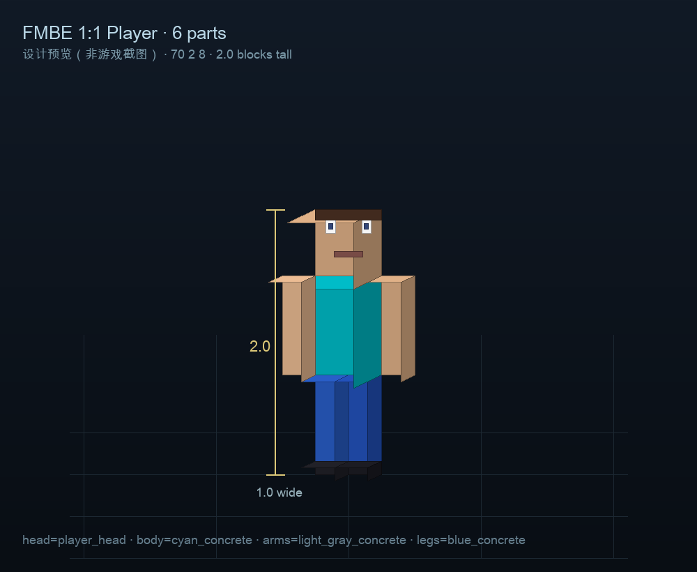

# FMBE 1:1 Player（6 部件）

用 6 只 FMBE 狐狸拼出的 1:1 方块玩家：头 + 身体 + 双臂 + 双腿，整体约 **1.0 格宽 × 2.0 格高**。



> 预览图是设计示意，不是游戏截图。实际外观以进服为准。

## 服务器部署

- 展示坐标：`70.5 2 8.5`（模型中心；脚底 y=2）
- 底座：`67 1 5` ~ `73 1 11` 的平滑石平台
- 命令方块：`64 210 0` 起，紧凑蛇形，90 个方块；无 tickingarea
- 服务器：28890143

## 六个部件

| 部件 | 实体 tag | 物品 | 缩放 |
|---|---|---|---|
| 头 | `pm_head` | `player_head`（`skull 3`） | 0.5 格，中心 `70.5 3.75 8.5` |
| 身体 | `pm_body` | `cyan_concrete` | 0.5 × 0.75，中心 `70.5 3.125 8.5` |
| 左臂 | `pm_arm_l` | `light_gray_concrete` | 0.25 × 0.75，中心 `70.125 3.125 8.5` |
| 右臂 | `pm_arm_r` | `light_gray_concrete` | 0.25 × 0.75，中心 `70.875 3.125 8.5` |
| 左腿 | `pm_leg_l` | `blue_concrete` | 0.25 × 0.75，中心 `70.375 2.375 8.5` |
| 右腿 | `pm_leg_r` | `blue_concrete` | 0.25 × 0.75，中心 `70.625 2.375 8.5` |

## 初始化 / 重置

```mcfunction
scoreboard players set pm_init pm 0
scoreboard players set pm_render pm 0
kill @e[tag=pm_model]
```

初始化链会清掉展示区狐狸、重新召唤 6 只、给物品/隐身/抗性/缓慢、锚定到各自的**部件中心**，然后渲染链跑一遍 FMBE 8 条命令。

- 渲染链：1 Hz 刷新，避免 20 Hz 的 48 条 Molang 命令造成卡顿。
- 锚定链：每 tick 按部件 tag 分别 `tp` 到各自中心，防止狐狸走散。
- 关键修复：**一个部件一只狐狸，狐狸站在部件中心**；不要再把 6 只狐狸堆在同一个基点靠 `v.pos` 偏移，否则头/身体会前后错位。
- 想改位置：同时改初始化/锚定/`v` 偏移；只改坐标会让部件错位。

## 已知限制

- FMBE 是**客户端视觉**，服务端只能验证狐狸/物品/tag；无头 bot 不能截图。
- 头用 `player_head`，身体/四肢用混凝土；不是皮肤级 1:1，而是 6 个方块部件。
- 如果模型整体漂浮/下沉，调所有部件的 y 坐标；如果前后偏移，调所有部件的 z 坐标。
- 当前同时写 `xzscale/yscale`（普通版）和 `extend_scale/extend_xrot=90`（EX 版），兼容两种 FMBE 运行时。
- 狐狸仍会被玩家推挤，锚定链每 tick 拉回。
