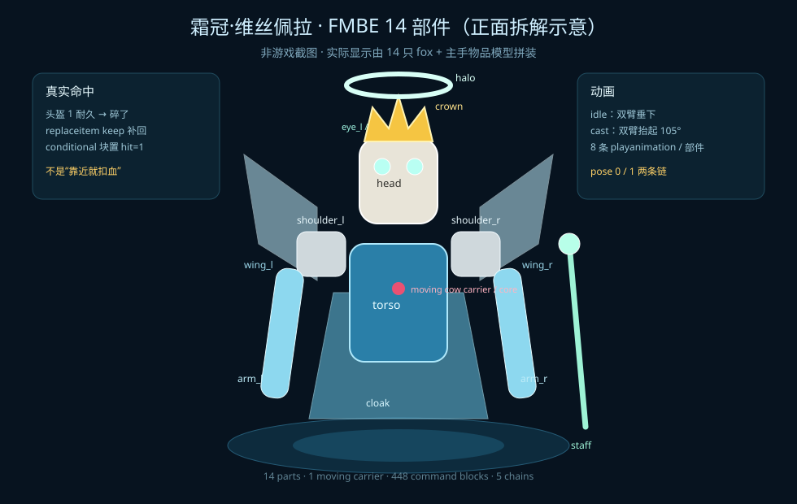

# 霜冠·维丝佩拉 v3 · FMBE 移动版

> 网易 1.21.130 · 14 部件 FMBE 冰霜女王 + **1 只自带 AI 的隐形僵尸** + 真实命中检测。
> 这是对早期“劫掠兽 + `hasitem` 近身判定”v1 的修正版；v1 未随本示例提供。



## 1. 修了什么

| v1 的问题 | v3 的做法 |
|---|---|
| Boss 是一头劫掠兽，不是 FMBE | 14 只 fox 部件（头/冠/光环/双眼/躯干/双肩/双臂/法杖/披风/双翼） |
| 扣血靠“手持下界合金剑 + 距 Boss 5 格” | 载体戴 **1 耐久皮革头盔**；每 tick `replaceitem ... keep` 只在头盔碎掉（真的被击中）时补上；紧跟的 **conditional 块**读这次成功 → `hit=1`，才扣血 |
| 没有模型动画 | 两套 8 条 `playanimation` 链：`idle`（待机）和 `cast`（施法）；`ct` 技能前摇自动切姿态，每 2 tick 刷新 |
| Boss 固定站在中心 | 隐形僵尸用**自己的 AI** 追玩家；不带任何移动 `tp`。14 个部件以僵尸为原点相对 `tp`，整只模型跟着它走 |
| 单核心容易被模型挡住 | 僵尸在模型中心地面，FMBE 部件在它上方；僵尸自己就是受击核心 |

## 2. 文件

| 文件 | 作用 |
|---|---|
| `frostcrown-arena.bdx` | 冰窟竞技场 + 机关平台（StartPos `500 0 500`） |
| `frostcrown-commands.bdx` | **432 个命令方块**（5 条链：init_a / init_b / main / pose_idle / pose_cast） |
| `spec.json` | 可被 `chain_lint.py` 检查的链描述 |
| `design.md` | 行为契约、FMBE 表、移动/命中原理、状态机、测试 |
| `import-report.md` | 真机导入/移动/命中记录 |
| `fmbe-parts.svg` | 14 部件拆解示意 |
| `build_frostcrown_fmbe.py` | 生成器（含僵尸 AI 载体） |
| `readbdx.py` | BDX 回读，逐块对 spec |
| `import-info.json` | StartPos / 块数 |

> 不提交 432 块的 `manual-build.md` / `lint.md`；运行生成器和 lint 会本地生成。

## 3. 坐标与导入

```text
竞技场建筑 StartPos       500 0 500
竞技场中心                515 2 515（地板 y=1）
命令方块 StartPos         506 42 506
init A head（impulse）    506 43 506   Needs Redstone
init B head（impulse）    506 43 516   Needs Redstone
main  head（repeat）      506 42 506   Always Active
pose_idle head（repeat）  506 44 506   Always Active，delay 2
pose_cast head（repeat）  506 44 518   Always Active，delay 2
触发红石块 A              505 43 506
触发红石块 B              505 43 516
```

1. 先把 `frostcrown-arena.bdx` 导入到 `500 0 500`。
2. 再把 `frostcrown-commands.bdx` 导入到 `506 42 506`；**逐块 repair**（`tp` 到方块旁 → `setblock` → `CommandBlockUpdate`），
   只摆方块不算导入成功。
3. `ia01/ib01` 必须保持 **Needs Redstone**；`m01/pi01/pc01` 必须 **Always Active**。
4. 同时放红石块到 `505 43 506` 和 `505 43 516`（两条 init 链），应看到 14 个 FMBE 部件、1 只隐形僵尸、行动栏复位提示。
5. 走进 `515 2 515` 开战；Boss 会开始追最近玩家。

> **关键条件块**：`m06` 必须是 **conditional**，紧贴在 `m05`（replaceitem）后面；
> 它靠上一条命令的成功次数判断“头盔是不是刚碎”。这一块放错，真实命中就失效。

## 4. 真实命中（载体）

```mcfunction
# m05：头盔还在时 keep 不替换 → 成功 0；只有头盔碎了才补 → 成功 1
replaceitem entity @e[tag=boss_core] slot.armor.head 0 keep leather_helmet 1 9999

# m06：conditional 块，只有 m05 成功才执行
scoreboard players set hit bs 1
```

- `9999` 是“下一次受击就碎”的护甲数据；僵尸戴 1 耐久头盔，被打后头盔消失，`keep` 成功补回。
- `hit` 只由这个事件置 1；距离、`hasitem`、手持武器都不再参与。
- `hit` 在伤害结算末尾清 0，保证一次命中只扣一次。
- 真机小链验证：`BEFORE 0 → 打一下 AFTER1 1 → 再打一下 AFTER2 2`。

## 5. 僵尸 AI + 模型绑定

**怪物自己动，不 tp 怪物。**

```mcfunction
# 召唤一只隐形僵尸；它自己会锁定并走向玩家
summon zombie 515.5 2 515.5
effect @e[tag=boss_core] invisibility infinite 255 true
effect @e[tag=boss_core] resistance infinite 4 true
effect @e[tag=boss_core] regeneration infinite 4 true
effect @e[tag=boss_core] fire_resistance infinite 255 true
effect @e[tag=boss_core] health_boost infinite 4 true
effect @e[tag=boss_core] weakness infinite 255 true
effect @e[tag=boss_core] speed infinite 1 true
```

- **没有任何 `tp @e[tag=boss_carrier]` 移动命令**；僵尸的寻路/追击完全交给原版 AI。
- `speed` 让它追得上玩家；`weakness 255` 防止它把玩家秒了；`fire_resistance` 防白天燃烧。
- FMBE 只做“绑定”，每 tick 以僵尸为原点：

```mcfunction
execute as @e[tag=boss_p_head] at @e[tag=boss_carrier] run tp @s ~0 ~5.4 ~0
execute as @e[tag=boss_p_torso] at @e[tag=boss_carrier] run tp @s ~0 ~4.2 ~0
# ...其余 12 个部件同理
```

- 僵尸脚底 y=2，部件偏移按 `原绝对 y - 2` 重算；模型在僵尸上方。
- 世界轴 `~` 偏移保证 14 个部件不会散；僵尸走/停，模型整体跟随。
- **当前限制**：模型保持南向，不随僵尸 yaw 转身；先保证拼接和 AI 追击。
- 实测：bot 放东侧 `520 2 516`，僵尸自己走到 `AT_520_516`，`PARTS 14 / CORES 1`。

## 6. 战斗

- 6000 HP；4000 进二阶段（冰甲 + 2 冰晶），2000 进三阶段（暴雪 + 技能加速）。
- 普通命中 40；破防 3 秒双倍；冰甲期只冒白烟、不扣血。
- 技能：霜环（r6.5 / 18 魔法 / 减速）、冰魂（2 只流浪者，上限 3）。
- 4 秒无人团灭；放两块红石复位。
- 僵尸不在开战时可能也会被附近玩家吸引；这是原版 AI 的代价。

## 7. 自检

```bash
python3 build_frostcrown_fmbe.py
python3 ../../scripts/chain_lint.py spec.json --format markdown --write lint.md
python3 readbdx.py frostcrown-commands.bdx
```

`readbdx.py` 回读：432 个命令方块，5 个链头，坐标/朝向/模式/延迟/条件/命令文本全部与 spec 一致。

真机（租赁服）：

```text
PARTS 14 / CORES 1 / UNIQUE 14
ST 1  HP 6000
僵尸 AI 移动标记：AT_520_516
damage @e[tag=boss_core] 10 entity_attack
AFTER HP 5960  HIT 0
```

结论：僵尸用自己的 AI 追玩家，模型以它为中心整体跟随；扣血仍只由“僵尸真实被击中”触发。客户端仍需目视确认 14 部件遮挡。

FMBE 参考资料：[FMBE Hub](https://fmbe-hub.ora-san.org/)、[Bedrock Wiki: Display Entities](https://wiki.bedrock.dev/commands/display-entities.html)。
