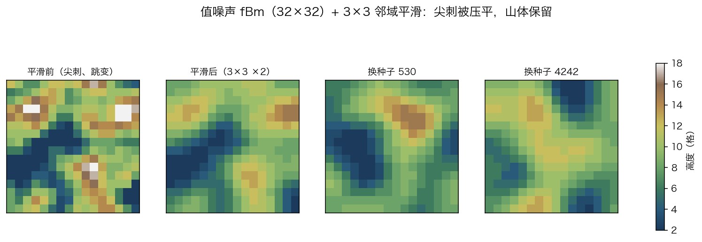

> **技能示例**：完整实现 + 可导入 BDX。通用模式见
> [`references/value-noise-terrain-machine.md`](../../references/value-noise-terrain-machine.md)。
> 本目录不含服务器导入脚本；导入用你自己的 BDX 导入器/命令方块数据包工具。

# 值噪声地形发生器（MCBE 命令方块 · 32×32 · 带邻域平滑）

**一句话**：256 个隐形盔甲架当 **32×32** 地形的 256 根 2×2 柱子，命令方块里用 32 位整数跑三层
**值噪声**（晶格哈希 + 1/256 定点双线性 + fBm），再用 **3×3 邻域均值跑两遍**把尖刺压平，
最后映射成 2..18 的 17 档高度铺方块。每轮开头抽新种子，所以每次生成都不一样。



| 想直接玩 | 想看懂 | 想改 |
|---|---|---|
| 导入 `terrain.bdx` 到 `(0,64,0)`（墙 16×27 + 南侧 32×32 空地） | [`design.md`](design.md) | `noise.py` 的 `SMOOTH_PASSES`/`DIV`/`GRID_W` |
| 没自动开始：`setblock 0 64 0 redstone_block` | [`plan.md`](plan.md) 429 行构建表 | 改完跑 `./run_all.sh` |

## 成品参数

- 10 条链 / **429** 命令方块 + 1 红石块；墙 16×27×6 + 地形 **32×32**
- `boot` 78 · `prep` 14 · `grid` 24（每 tick 2 根）· `calc1..6` 82/82/27/22/22/5（噪声/平滑/收尾）· `draw` 73（17 档）
- 256 根柱子 + 1 游标；17 个 objective、28 个常量
- 平滑：3×3 均值 ×2 遍，**边界按实际邻居数归一化**；相邻高差 1.96 → **0.98 格**
- 高度 2..18（17 档），h≥14 雪顶；每轮随机种子（0..20000），chat 打印种子，可复现
- 静态检查 **0 error**（1 条 `LONG_CHAIN 81` 提醒）；BDX 回读逐块一致
- 离线解释器：连跑两轮（含重触发），256 格高度与模型（含两遍平滑）**逐格相同**
- 真机：v1（457 块）连续触发两次，种子 5170、14700 两轮的高度分布**都与模型逐档相同**；
  v2（429 块）导入后 `ST=99 / SEED=13337 / B=17`，17 档分布 `11,9,4,8,20,13,27,30,30,44,30,22,7,1,0,0,0`
  也与模型**逐档相同**
- 优化：v2 比 v1 **少 28 个命令方块**（457→429，-6.1%），地形/种子/平滑结果逐格不变
  - `grid` 33→24：去掉对 256 根柱子的全表扫描，改游标处局部选择器；A/B 共享 px/pz 基准
  - `calc` 251→240：坐标直算、删 `+=0`、平滑用中心值初始化
  - `boot` 86→78：删 2 个 objective、5 个未用常量、1 个快照

## 复现

```bash
./run_all.sh              # gen → lint → sim → preview → readbdx
python3 sim.py 400 42     # 换随机种子跑离线模拟；它会连跑两轮验证"重触发"
```

## 目录

```
terrain.bdx          成品（导入即用）
design.md            算法/平滑/种子/踩坑/验证
plan.md              linter 构建表（429 行）
spec.json            链的声明式描述
noise.py             值噪声 + 平滑模型
gen.py               生成器
sim.py               离线解释器
preview.py/png       平滑前后对比 + 换种子
readbdx.py           BDX 回读校验（逐块对 spec）
run_all.sh           一键复现
```

## 算法 30 秒版

```text
salt = 本轮随机种子
for 每根柱子 (px,pz)（1..31 奇数）:
  for (L,seed,amp) in [(8,11,2), (4,47,2), (2,83,1)]:
      acc += 双线性(四角 H(a)=(a*(a+1))%251，a 里含 seed+salt) * amp
  hgt = 38 + (acc-625)/30          # 中间高度，不夹断
hgt = 2 遍 3×3 邻域均值(hgt)        # 边界按邻居数归一化
hgt = clamp(hgt-28, 2, 18)         # 17 档
按档铺 stone/dirt/grass(或 snow)
```

平滑照 skill 的 `gaussian-filter.md`，但把邻域采样从实体搬到计分板；
与 `value-noise-7cmd.md` 的对照见 [design.md](design.md) §3。
