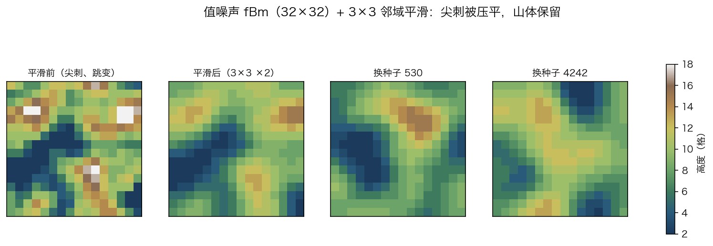

# 值噪声 fBm + 邻域平滑 地形发生器（MCBE / 网易 1.21.130）

> **一句话**：256 个隐形盔甲架当 **32×32** 地形的 256 根 2×2 柱子，命令方块里用 32 位整数跑
> 三层值噪声（晶格哈希 + 1/256 定点双线性 + fBm）得到"中间高度"，
> 再用 **3×3 邻域均值跑两遍**（边界按实际邻居数归一化）把尖刺压平，
> 最后映射成 2..18 的 17 档高度铺方块。每轮开头抽新种子 → 地形不重复。



*（离线渲染：① 平滑前的尖刺 ② 平滑后 ③④ 换两个种子。真机回读见 §9。）*

---

## 1. 行为契约

| 项 | 内容 |
|---|---|
| **谁触发** | `boot00`（impulse + Needs Redstone）由 `(0,64,0)` 的红石块触发一次；boot 第一条命令就把红石块换成空气 |
| **起始** | 清场 → 圈常加载（墙+地形）→ 17 个 objective → 28 个常量 → 抽种子 → 状态 10 |
| **中间** | prep 等 2 tick → grid 每 tick 2 根柱子（128 pass）→ 6 条 calc stage（噪声 → 中间高度 → 平滑×2 → 收尾）→ draw 每 4 tick 一档（17 档） |
| **结束** | 32×32 地形（2..18 格，h≥14 雪顶），`§a地形生成完成` + levelup + **高度分布自检** |
| **失败** | 所有几何都相对柱子实体；柱子没了就什么都不铺；重放红石块即可重来 |
| **重置** | 重放红石块：kill 旧柱子、清空地形体、**换种子**、重扫重算 |

整轮 ≈ 193 tick（约 10 秒）：prep 2 + 扫描 128 + 计算 6 + 铺设 68（取整后与实际 193 差几 tick）。

---

## 2. 算法

### 2.1 三层值噪声

```text
for 每根柱子 (px, pz)，px/pz = 1,3,..,31：
  for L, seed, amp in [(8,11,2), (4,47,2), (2,83,1)]:
      v = value_noise(px, pz, L, seed + salt)     # 0..250
      acc += v * amp                               # acc ∈ [0, 1250]
  raw = 38 + (acc - 625) / 30                      # 中间高度，不夹断
```

一层值噪声：

```text
ix = (px + 相位偏移) / L            # 只有 L=8 层有 (2,1)
fx = ((px + 相位偏移) % L) * (256/L)
a  = ix*127 + iz*311 + (seed+salt) + (dx*127 + dz*311)
H(a) = a*(a+1) % 251               # 0..250，非负、无浮点、无梯度
v  = (H00*fx2*fz2 + H10*fx*fz2 + H01*fx2*fz + H11*fx*fz) / 65536
```

### 2.2 平滑：3×3 邻域均值 ×2

照 skill 的 `gaussian-filter.md`，但把"邻域采样"从实体搬到计分板：

```mcfunction
# acc 在 map 之后空闲，复用它做邻域和；中心先入账
execute as @e[tag=nt_col] at @s run scoreboard players operation @s acc = @s hgt
execute as @e[tag=nt_col] at @s run scoreboard players set @s cnt 1
# 每个偏移（8 个，±2 格）各两条：
execute as @e[tag=nt_col] at @s positioned ~-2 ~ ~-2 if entity @e[tag=nt_col,r=0.6] run scoreboard players operation @s acc += @e[tag=nt_col,r=0.6,c=1] hgt
execute as @e[tag=nt_col] at @s positioned ~-2 ~ ~-2 if entity @e[tag=nt_col,r=0.6] run scoreboard players add @s cnt 1
# 收尾：
execute as @e[tag=nt_col] at @s run scoreboard players operation @s acc /= @s cnt
execute as @e[tag=nt_col] at @s run scoreboard players operation @s hgt = @s acc
```

- **边界按实际邻居数 `cnt` 归一化**：角落只有 4 个邻居也不会被"拉暗"，
  这是样本那套 3×3 高斯核在边缘会出现的偏置，用计数除法直接消掉；
- 跑 **两遍**（box ×2 ≈ 高斯）：相邻高差从 1.96 格降到 0.98 格，山体还在；
- 一条 `execute as ... at @s positioned` 就处理全部 256 根柱子，**不产生任何新实体**
  （样本要靠 t/boat/f 一堆锚点做方向分叉）。

### 2.3 映射与档位

```text
hgt = clamp(hgt - 28, 2, 18)     # 平滑后 → 2..18
salt=0 的模型高度分布：2:20 3:12 4:13 5:15 6:17 7:13 8:33 9:31 10:39 11:28 12:20 13:9 14:2 15:4；换种子会整体移动/变峰
```

### 2.4 种子：每轮不同、可复现

```mcfunction
scoreboard players add fb_seed nz 1                  # 兜底
scoreboard players operation fb_seed nz %= ksalty nz  # 夹回 0..20000
scoreboard players random fb_seed nz 0 20000          # 正菜
```

种子只进哈希输入；上限 20000 保证 `a*(a+1) ≈ 5.6e8 < 2^31`。
想复现：`scoreboard players set fb_seed nz <chat 里的数>` 再触发。

### 2.5 溢出边界

| 量 | 量级 |
|---|---|
| 哈希输入 `a` | ≤ 7*127 + 7*311 + 521 + 20000 ≈ 2.4e4 |
| `a*(a+1)` | ≈ 5.6e8 |
| 角权重 `H*fx2*fz2` | ≤ 1.64e7 |
| 平滑 `acc` | ≤ 57*9 ≈ 513 |

全部 < 2^31。

---

## 3. 和 skill 两份新样本的对照

### 3.1 `gaussian-filter.md`（高斯滤波 / 表面平滑）

| 样本 | 本项目 | 为什么 |
|---|---|---|
| 二分表面搜索（16→8→…→0.5，`unless block`) | 不需要：高度在计分板里 | 我们不是"从世界读表面"，而是"自己算出高度" |
| t/boat/f 实体做 NX 方向分叉 | `positioned ~dx ~ ~dz` 九个偏移 | 邻域是固定 3×3 网格，不需要方向树 |
| 3×3/5×5 加权核 | 3×3 均值 ×2 遍 | box×2 ≈ 高斯，命令数从"几十条长命令"降到 44 条 |
| `fill air replace grass` 再铺草 | 直接铺 17 档 | 高度已知，不需要先铲后填 |
| `kill @e[tag=!f]` | `kill @e[tag=nt_col]` | 样本的清理会误杀玩家/宠物 |

**保留的核心**：邻域加权平均（把尖刺压平、保留大形体）、边界处理、两遍近似。

### 3.2 `value-noise-7cmd.md`（7 命令 NX 噪声核）

| 样本 | 本项目 | 为什么 |
|---|---|---|
| `nxs` 多层分叉一次生成整组采样点 | 1 条 `execute as @e[tag=nt_col]` 就是 256 路并行 | 实体本身就是并行度，不需要 N^k 分叉 |
| 靠浮点坐标/精度折叠 | 计分板整数哈希 | 可复现、不依赖版本 |
| `fill ~0.5~ ~ -60~` 一列 | 17 档常量 `fill` | 高度已知，坐标必须常量 |
| 7 条命令 = 核，不含循环 | 10 条链 = 完整机器（含扫描/种子/平滑） | 交付要的是"能长地形"，不是核 |

**保留的核心**：四角晶格 + 插值 + 实体当坐标。

---

## 4. 数据布局

| 名 | 载体 | 说明 |
|---|---|---|
| `fb_seed` | `nz` | 本轮种子 0..20000 |
| `fb_state` | `ctl` | 10 准备 / 1 扫描 / 2-7 各 stage / 8 铺设 / 99 完成 |
| `fb_cur` | `ctl` | 链头状态快照（防同 tick 级联；draw 也复用它） |
| `fb_cx` `fb_cz` `fb_n` | `ctl` | 扫描游标列 0..7、行 0..15、计数 0..256 |
| `fb_b` | `ctl` | 铺设档位 0..16 |
| `bn2..bn18` | `ctl` | 每档铺了多少根柱子（自检） |
| `px` `pz` | objective | 采样坐标（1,3,..,31） |
| `hgt` | objective | 中间高度 → 平滑 → 最终 2..18 |
| `acc` `cnt` | objective | 平滑的邻域和（复用 acc）/ 邻域数 |
| `acc` `base` `hh` `bi` `u` `ix` `fx` `fx2` `iz` `fz` `fz2` `t` | objective | 噪声临时寄存器 |

---

## 5. 状态机与链

```text
S10 准备 ─2t─► S1 扫描 ─128t─► S2..S4 噪声/中间高度 ─► S5 平滑1 ─► S6 平滑2 ─► S7 收尾 ─► S8 铺 0..16 档 ─68t─► S99
```

| 链 | 类型 / 延迟 | 方块数 | 说明 |
|---|---|---|---|
| `boot` | impulse | 78 | 清场、圈常加载、objective、常量、抽种子、**清计数器** |
| `prep` | repeat / 2 | 14 | 地板、清空体、召唤游标 |
| `grid` | repeat / 1 | 24 | 每 tick 两根柱子（A/B），写 px/pz |
| `calc1..3` | repeat / 0 | 82/82/27 | 三层噪声 + 中间高度（按 80 条切 stage） |
| `calc4` | repeat / 0 | 22 | 平滑第 1 遍 |
| `calc5` | repeat / 0 | 22 | 平滑第 2 遍 |
| `calc6` | repeat / 0 | 5 | −28、夹 2..18 |
| `draw` | repeat / 4 | 73 | 每 4 tick 一档，17 档 |
| **合计** | | **429** | 最大链深 81 |

---

## 6. 布局

```text
y=+0   boot 78      y=+1  prep 14     y=+2  grid 24
y=+4..+9  calc1..6 82/82/27/22/22/5  y=+26 draw 73
```

地形区：`x=0..31`、`z=24..55`（墙在 z=1..6，隔 18 格）。

---

## 7. 构建表

完整 429 行见 **[plan.md](plan.md)**：**0 error** / 1 warning（`LONG_CHAIN 81`）/ 2 info。

---

## 8. 六个坑

### 8.1 `as` 之后必须 `at @s`，`positioned` 才相对实体

`execute as @e[tag=nt_col] positioned ~-2 ~ ~-2` 是相对**命令方块**的坐标！
漏掉 `at @s` 会让所有柱子都去采样命令墙旁边那块空气 → 平滑值全 0。
正解：`execute as @e[...] at @s positioned ~-2 ~ ~-2 ...`。

### 8.2 `~+2` 不是合法坐标

`f"~{+2:+d}"` 会生成 `~+2`，基岩版解析失败。要么写 `~2`，要么用 `~0`。

### 8.3 行尾换行少算 4 格

扫描 8 根 × 4 格 = 32：第 8 对柱子放完时游标在 `x=29`，所以换行是 `tp ~-28 ~ ~2`。
差这 4 格，第二行整体左移，`px/pz` 和世界坐标错位（平滑就会把不相邻的柱子平均到一起）。

### 8.4 平滑必须在"不夹断"的域里做

先把高度夹到 2..18 再平滑，等于把超出的部分砍掉，山体会变成平台。
正解：中间高度用 38 偏移（约 19..57）不夹断，平滑完再 −28、夹 2..18。

### 8.5 边界要按邻居数归一化

角落只有 4 个邻居，固定除以 9 会让边缘整体下沉。用 `cnt` 计数再除。

### 8.6 重触发必须清计数器（否则"秒完成"）

`fb_n`（扫描计数）`fb_b`（铺设档位）这些是**跨轮保留**的分数。
重写 32×32 版时漏了清零：第一轮跑完 `fb_n=256`、`fb_b=18`，
再放红石块时 grid 第一拍就命中 `fb_n >= 256` 直接跳到计算，
draw 又从 18 档开始、直接进收尾 —— 于是"启动 1-2 秒就提示生成完成，但什么都没长"。
正解：boot 里把 `fb_cx/fb_cz/fb_n/fb_b/fb_t/fb_cur` 全部清零（prep 里再兜一次）。
`sim.py` 现在会**连跑两轮**来抓这类"只在第二轮出现"的 bug。

### 8.7 区块加载：boot 和 prep 分开

`fill`/`summon` 在未加载区块里静默失败。boot 先 `tickingarea add`，2 tick 后 prep 再动土。

---

## 9. 验证

### 9.1 静态检查

```bash
chain_lint.py spec.json --format markdown --write plan.md
# 429 blocks / 0 error / LONG_CHAIN 81 / 10 heads
```

### 9.2 离线解释器

```text
--- run 1 完成于第 193 tick，种子 2099
--- run 2 完成于第 386 tick，种子 18138
ticks=400 entities=257 cols=256 blocks=21505
final state: 99 scan: 256 band: 17
✓ 256 根柱子的 hgt 与 noise.py 模型逐格相同（含 2 遍平滑）
✓ 每列从 y=2 到顶面连续，顶面是草/雪
✓ 雪顶柱 5 根（h≥14）
高度分布: {3:17, 4:20, 5:26, 6:25, 7:26, 8:27, 9:28, 10:22, 11:21, 12:22, 13:17, 14:5}
```

平滑效果（模型统计）：相邻高差 **1.96 → 0.98 格**。

### 9.3 真机（网易 1.21.130 租赁服）

**v1（457 块）** → 连续触发两次 → 回读：

```text
R1 SEED 5170  ST 99  N 256  B 17
R1 H 2:0 3:2 4:3 5:7 6:14 7:22 8:21 9:47 10:52 11:37 12:16 13:14 14:13 15:4 16:4 17:0 18:0
R2 SEED 14700 ST 99  N 256  B 17
R2 H 2:0 3:1 4:17 5:27 6:24 7:35 8:47 9:36 10:26 11:26 12:10 13:6 14:1 15:0 16:0 17:0 18:0
```

两次都 `N=256`（不是 272/512 —— 计数器确实清了），两次种子不同、高度分布不同。

**与模型逐档对照**：

| 种子 | 游戏内 | 模型 | |
|---|---|---|---|
| 5170 | 0,2,3,7,14,22,21,47,52,37,16,14,13,4,4,0,0 | 同左 | ✓ 逐档相同 |
| 14700 | 0,1,17,27,24,35,47,36,26,26,10,6,1,0,0,0,0 | 同左 | ✓ 逐档相同 |

**v2（429 块）** 导入后冻结命令方块，读回同一轮的全局状态与 17 档计数：

```text
ST 99  SEED 13337  B 17
H 2:11 3:9 4:4 5:8 6:20 7:13 8:27 9:30 10:30 11:44 12:30 13:22 14:7 15:1 16:0 17:0 18:0
```

`noise.py` 用 seed=13337 复算：`[11,9,4,8,20,13,27,30,30,44,30,22,7,1,0,0,0]`，**逐档相同，和 256**。
说明 v2 的 grid 局部选择器、共享 px/pz、坐标直算、平滑中心初始化都没有改变输出。

也就是说：32×32 的 256 格、两遍 3×3 平滑、随机种子，游戏里跑出来的高度分布
和 `noise.py` 用同一颗种子算的**完全一致**。

### 9.4 "秒完成"的回归测试

`sim.py` 现在默认**连跑两轮**（第一轮结束后重新触发 boot）：

```text
--- run 1 完成于第 193 tick，种子 2099
--- run 2 完成于第 386 tick，种子 18138
✓ 256 根柱子的 hgt 与 noise.py 模型逐格相同
✓ 每列从 y=2 到顶面连续，顶面是草/雪
```

第二轮如果不清 `fb_n/fb_b`，会在第一拍就"完成"——这个测试就是用来抓它的。

---

## 10. 导入与调参

1. 导入 `terrain.bdx` 到 `(0,64,0)`（BDX 里已是 y=64 基准）。
2. 命令方块数据包**逐块**写入：`tp` 到方块旁 → `setblock` → 数据包；再补一遍"只发数据包"的修复遍。
3. 这份地图的导入器不认"总是开启"：10 个 repeat 链头各贴一个红石块（`(x,y,z-1)`）。
4. 触发：`setblock 0 64 0 redstone_block`。

| 想改 | 改哪里 |
|---|---|
| 平滑强度 | `noise.py` 的 `SMOOTH_PASSES`（1/2/3） |
| 起伏 | `DIV`（小=更陡）/ `MID_RAW`、`OFF_RAW` |
| 范围 | `GRID_W`（16 → 32×32；20 → 40×40） |
| 层数 | `OCTAVES` |
| 档位 | `H_MIN`/`H_MAX` 与 draw 的档位循环 |

---

## 11. 红队

| 风险 | 现象 | 处置 |
|---|---|---|
| 实体数 | 256 根柱子 + 游标 | 远低于上限；再大就分批生成 |
| 计算量 | 6 个 stage × 256 实体 | 每个 stage ≤ 80 条，单 tick ≤ 2 万次分数运算 |
| `fill` 体积 | 32×32×17 ≈ 1.7 万格 | 分 17 档、每档只填自己的列 |
| 区块加载 | 未加载 → 静默失败 | boot 先圈常加载，prep 2 tick 后再动土 |
| 导入丢包 | 方块在、命令空 | 逐块 + 修复遍 + 触发后看 `fb_seed` |
| 重复触发 | 换种子重来 | 幂等，约 10 秒 |

---

## 12. 文件

| 文件 | 作用 |
|---|---|
| `terrain.bdx` | 可导入成品（429 命令方块 + 1 红石块） |
| `noise.py` | 噪声 + 平滑模型（含 `blur_once`/`smoothed`） |
| `gen.py` | 生成器（stage 切分、17 档 draw） |
| `sim.py` | 离线解释器（`scoreboard random`、`positioned`、`r` 选择器） |
| `preview.py` / `preview.png` | 平滑前/后 + 换种子 |
| `spec.json` / `plan.md` | 声明式描述 / linter 构建表 |
| `readbdx.py` | BDX 回读校验（逐块对 spec） |
| `run_all.sh` | 一键复现（生成 → lint → sim → 预览 → BDX 回读） |

---

## 13. v2 优化（457 → 429，-28 块）

地形、种子、平滑结果**逐格不变**，只压命令数和对实体的全表扫描：

| 位置 | v1 | v2 | 怎么省的 |
|---|---|---|---|
| `grid` | 33 | **24** | ① 不再 `@e[type=armor_stand] unless ...` 全表扫 256 根柱子，改成游标处 `r=0.6` 局部选择器；② A/B 两根柱子共享一次 `px/pz` 基准计算 |
| `calc` | 251 | **240** | ① 无相位层的坐标直接算 `ix/(fx)`，不再经 `u` 中转（-4）；② 角 0 偏移是 0，删掉 `hh += 0`（-3）；③ 平滑用中心值初始化 `acc=hgt, cnt=1`，8 个邻居循环（-4） |
| `boot` | 86 | **78** | 删掉 `t`/`sm` 两个 objective、5 个未用常量、`fb_cur_d` 快照 |
| `draw` | 73 | 73 | 不变（17 档的 4 条/档是必要成本） |
| **合计** | **457** | **429** | **-6.1%** |

v2 真机结果（seed 13337）与模型逐档相同；完整命令方块墙的逐块回读由 `readbdx.py` 离线完成。跑 `./run_all.sh` 会验证：

```text
blocks=429  bdx items=430  calc stages=6
Blocks: 429 / 0 error / LONG_CHAIN 81 / 10 heads
run 1 第 193 tick 种子 2099 → run 2 第 386 tick 种子 18138
真机 v2：ST 99 / SEED 13337 / B 17，17 档分布与模型逐档相同
✓ 256 根柱子的 hgt 与 noise.py 模型逐格相同
回读 OK：坐标/朝向/模式/延迟/条件/红石/命令文本/自定义名 全部与 spec 一致
```
