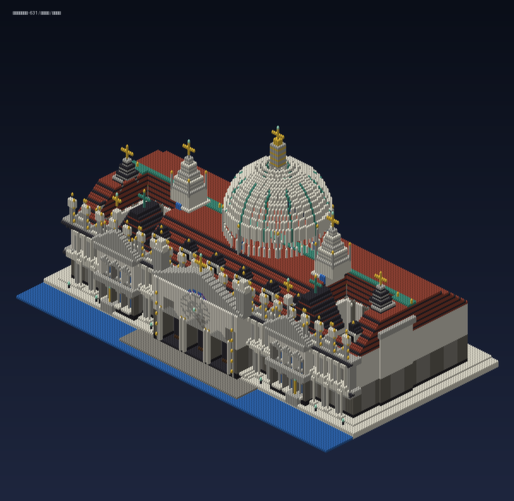

# 国会大厦 · 石冠（631 / 深度立面）



- 中心 `(300,0,300)`，StartPos `210 0 250`
- **303,020 方块**，180×100，穹顶/灯笼高 113
- 631：60% 长翼 + 内院，30% 中央门廊/穹顶/双塔，10% 灯笼/尖塔/玫瑰
- 从 Tolbooth 学石料混色/扶壁尖饰，从圣维蕾娜学内院回廊，从白金汉学五开间/端亭节奏
- 两座 28×28 内院 + 连拱回廊，避免实心盒子

## 文件

| 文件 | 说明 |
|---|---|
| `design.md` | 参考拆解、631、黄金比例、四层立面、内院、材质 |
| `parliament-631.bdx` | 303,020 方块 |
| `gen_parliament.py` | 生成器 |
| `front.png` / `iso.png` / `top.png` | 正立面 / 等轴测 / 总平面 |
| `plan.json` | 统计 |
| `import-report.md` | 真机导入 |

```bash
python3 gen_parliament.py
python3 preview.py
python3 top.py
```
