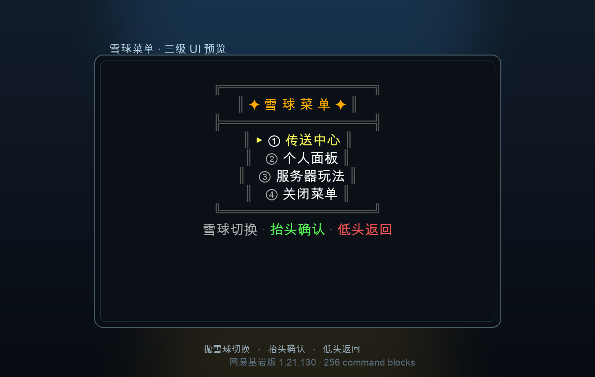

# 雪球菜单 · 三级 UI（网易 1.21.130）



一个纯命令方块实现的雪球菜单：

- **触发**：抛雪球打开/切换选项。
- **三级菜单**：主菜单 → 分类子菜单 → 操作/信息页。
- **导航**：抬头确认/进入，低头返回/关闭。
- **UI**：`actionbar` 的彩色边框面板，选中项 `▶` 高亮，底部操作提示；**没有大标题/副标题**。
- **功能**：回大厅、夜视、速度、个人属性、每日签到、菜单音效、规则/提示/关于、关闭。

## 文件

| 文件 | 说明 |
|---|---|
| `snowball-menu.bdx` | 256 个命令方块的结构文件（15×6×9，紧凑蛇形排布） |
| `snowball-menu.spec.json` | 可被技能 linter 校验的链描述 |
| `plan.md` | linter 生成的构建表（256 行） |
| `ui-preview.png` | UI 文字预览图（非游戏截图） |

## 菜单结构

```
主菜单 (sbm=1)
├─ ① 传送中心 → 子菜单 page=1
│   ├─ ① 回到大厅      → 确认页 page=1 → tp @s 64 2 0
│   ├─ ② 夜视体验      → 确认页 page=2 → night_vision 120s
│   ├─ ③ 速度提升      → 确认页 page=3 → speed II 60s
│   └─ ④ 返回主菜单
├─ ② 个人面板 → 子菜单 page=2
│   ├─ ① 查看属性      → 信息页 page=4（titleraw + score）
│   ├─ ② 每日签到      → 确认页 page=5 → +1 积分 +4 苹果 → page=10
│   ├─ ③ 菜单音效      → page=6 开关 → 返回
│   └─ ④ 返回主菜单
├─ ③ 服务器玩法 → 子菜单 page=3
│   ├─ ① 玩法规则      → 信息页 page=7
│   ├─ ② 新手提示      → 信息页 page=8
│   ├─ ③ 关于菜单      → 信息页 page=9
│   └─ ④ 返回主菜单
└─ ④ 关闭菜单
```

## 状态表

| 变量 | 载体 | 含义 | 初值 |
|---|---|---|---|
| `sbm` | 计分板 | 0=关闭 1=主菜单 2=子菜单 3=操作/信息 | 0 |
| `sbsel` | 计分板 | 当前高亮项 0..3 | 0 |
| `sbpage` | 计分板 | 子菜单 1..3；操作页 1..10 | 0 |
| `sblook` | 计分板 | 抬头边沿标记 0/1 | 0 |
| `sbdown` | 计分板 | 低头边沿标记 0/1 | 0 |
| `sbopen` | 计分板 | 打开次数（个人面板显示） | 0 |
| `sbpoints` | 计分板 | 积分（签到 +1） | 0 |
| `sbsnd` | 计分板 | 菜单音效 0/1 | 1 |
| `sbg` | 计分板 | 当前动作组 id（0=空闲） | 0 |

## 链结构（256 个命令方块）

| 层 | 作用 | 方块数 | 节拍 |
|---|---|---|---|
| Y=0 | 初始化目标/常量（幂等） | 13 | repeat delay 20 |
| Y=1 | 每玩家初始化分数 | 9 | repeat delay 20 |
| Y=2 | 雪球检测/打开/切换/回收 | 17 | repeat delay 0 |
| Y=3 | 抬头确认（边沿检测 + 动作组） | 135 | repeat delay 2 |
| Y=4 | 低头返回/关闭（边沿检测） | 54 | repeat delay 2 |
| Y=5 | UI 渲染（title/titleraw） | 28 | repeat delay 4 |

**紧凑排布**：每层在 15×15 的范围内蛇形走线，整座菜单只占 **1 个区块柱**（x 64..78，z 0..8，y 200..205）。

## 导入位置

示例部署坐标：

- 原点：`64 200 0`
- 尺寸：15×6×9
- 区块：`(4,0)`（x 64..79，z 0..15）
- **没有加 tickingarea**：玩家在出生点附近时该区块自然加载；无人时卸载，菜单不空转。
- 命令方块在 y=200，位于高空，不占用地表。

> 如果移动结构，请同步修改动作页 1 的 `tp @s 64 2 0`，改成你的安全回城点。

## 使用方式

1. 站在出生点/菜单所在区块内，手里有雪球。
2. 抛雪球：打开主菜单；再抛：高亮切换 ①→②→③→④。
3. 抬头：确认/进入；低头：返回/关闭。
4. 在操作页抛雪球：直接关闭菜单。

重置某个玩家：

```mcfunction
scoreboard players set <玩家> sbm 0
scoreboard players set <玩家> sbsel 0
scoreboard players set <玩家> sbpage 0
scoreboard players set <玩家> sblook 1
scoreboard players set <玩家> sbdown 0
```

## 已在服务器验证

验收记录（示例）：

- [x] `fill` 清掉旧版宽结构，导入紧凑版；256 个命令方块全部校验存在。
- [x] 抛雪球打开：`sbm=1`，`sbopen` 递增；只发 actionbar，不再发 `title`/`subtitle`。
- [x] 连续抛雪球：`sbsel` 0→1 循环。
- [x] 主菜单 ① → 子菜单 1 → 抬头 → 操作页 1；低头返回子菜单。
- [x] 主菜单 ② → 子菜单 2 → 每日签到：`sbpoints+1`、发 4 个苹果、跳到成功页。
- [x] 主菜单 ② → ① 查看属性：`titleraw` 个人属性页。
- [x] 操作页 1：`tp @s 64 2 0` 回大厅并关闭。
- [x] 无 tickingarea 时，玩家在出生点区块内菜单正常运行。
- [x] 捕获到 459 字节主菜单文本、378 字节签到成功文本、233 字节个人属性 JSON。
- [x] 主菜单高亮、边框、颜色、`▶` 选中标记在客户端正常渲染。

## 重新导入

`snowball-menu.bdx` 是标准 BDX，可直接用 AuroraBuild-cli、AuroraBuild 的 BuildTask 或其它 BDX 导入工具导入到 **`64 200 0`**。

- 结构尺寸 15×6×9，占一个区块柱；导入后建议逐块校验/回写命令方块 NBT（BuildTask 偶尔会漏 NBT）。
- 回城点写死在动作页 1 的 `tp @s 64 2 0`；改坐标后重新导入。
- 如果要改菜单文字/动作，编辑 `snowball-menu.spec.json` 或使用你自己的生成器；生成器不随本仓库提供。

## 设计说明

- **为什么用 `sbg` 而不是 tag**：动作组第一句改 `sbm/sbpage` 后，基于原状态的 selector 会失效；`sbg` 记录“当前动作组 id”，后续命令只按 `sbg` 过滤，避免状态变化把同组后续命令挡掉。
- **为什么用边沿检测**：抬头/低头是持续姿态；`sblook`/`sbdown` 保证一次姿态只触发一次动作。
- **为什么紧凑排布**：宽版 167 格会跨 9 个区块，必须加 tickingarea，256 个方块 24 小时空转；紧凑版只占 1 个区块柱，随玩家加载。
- **为什么 actionbar 文本控制在 512 字节内**：网易 1.21.130 的 `title`/`titleraw` 文本参数在超过约 512 字节时会静默失败；当前主菜单 459 字节、成功页 378 字节。
- **为什么不用 `camera`/`inputpermission`**：网易 1.21.130 未验证；表现层用 `camerashake`/`title`/`playanimation`。

## 测试清单

- [ ] 单次抛雪球：只出现 actionbar 菜单，没有大标题/副标题。
- [ ] 连抛 4 次：高亮循环回 ①。
- [ ] 抬头/低头各保持 1 秒：只触发一次，不连跳。
- [ ] 主菜单 ①→①：回大厅并关闭。
- [ ] 主菜单 ②→②：签到成功，积分与苹果数量正确。
- [ ] 主菜单 ②→③：音效开关切换并返回。
- [ ] 操作页抛雪球：关闭菜单。
- [ ] 两个玩家同时使用：`sbm/sbsel/sbpage` 互不串。
- [ ] 玩家离开区块再回来：菜单仍能打开。
- [ ] 重启服务器：命令方块 NBT 保留，菜单仍工作。
