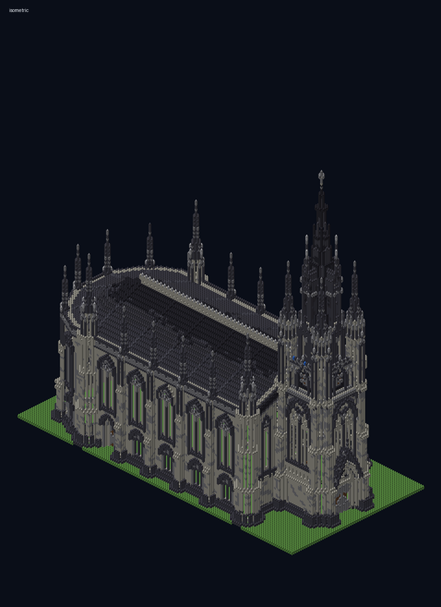
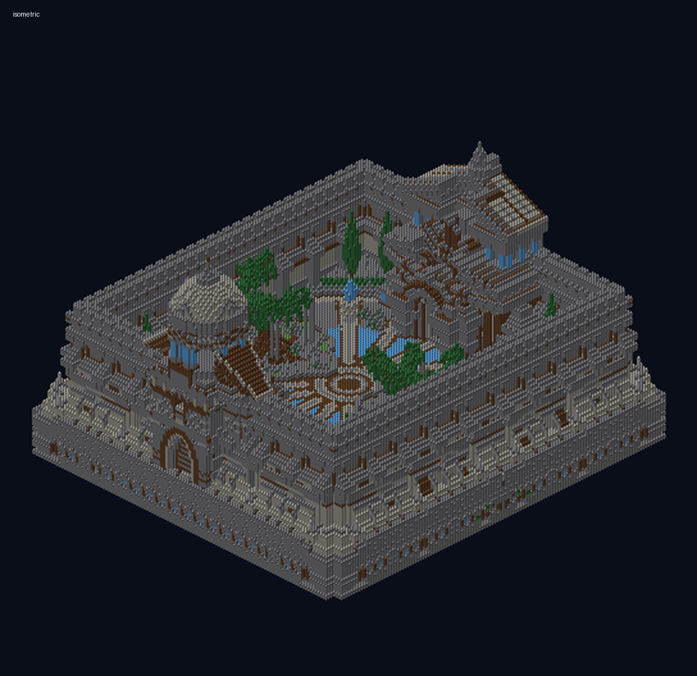

# 29 · 建筑语料：已索引的参考

> 本地参考，不随 skill 分发；源文件来自用户提供的建筑包。
> 只做风格/比例/材质提炼，不复制建筑本体。

## 已解析格式

- `.schematic`（MCEdit / WorldEdit，含 Sponge 伪装成 .schematic 的 Palette 格式）
- `.schem`（Sponge）
- `.litematic`（Litematica，位打包长数组）
- `.bdx`（普通方块）

工具：`work/architecture-corpus/fast_index.py` / `build_index.py`
参考摘要：`references/architecture-corpus/curated.json`

## 两个真正的 golden reference

### Tolbooth Kirk



```text
149 × 189 × 72      68,555 blocks
verticality 1.27     density 0.034
palette: polished_andesite / tuff / polished_deepslate / dark oak / glass
```

可学：

- **高宽比**：塔尖 189 高，进深仅 72；不是矮胖城堡
- **开间节奏**：扶壁—尖窗—扶壁，逐跨重复
- **尖饰列**：屋顶/扶壁顶部有连续 pinnacle，不是只有四个角
- **深窗**：窗洞有进深，玻璃前有石框
- **单主塔**：一端塔楼 + 长厅，不对称但重心稳

### Europe Castle



```text
154 × 127 × 175     422,573 blocks
verticality 0.73     density 0.124
palette: wool / hardened_clay / stone / oak / stained clay
```

可学：

- **内院**：建筑围合出真正的空腔，不是实心体
- **回廊/拱廊**：一层连续柱廊，形成灰空间
- **穹顶 + 长厅 + 塔**：多种屋顶类型，不是一种锥顶复制
- **庭院绿化/水景**：空腔里有尺度参照

## 失败/需过滤的样本

- `旧堕落城堡`：928×256×934，5,029 万方块，实际是地形/世界，不是单栋建筑
- `斯通希尔城堡`：2,977 万方块，地形主导
- `中世纪塔`：大面积 oak/brick，像完整地图而不是塔
- `卡斯蒂略城堡`：Sponge 格式且 186 种方块，预览出现大幅漂浮/断裂，需重新定位/裁剪

## 对 ArchBuilder 的直接修正

1. **垂直性**：主塔高/进深 ≥ 1.2；不要 120×120 的矮胖城堡
2. **开间**：每 6–8 格一个扶壁，窗在扶壁之间
3. **尖饰**：不是四角四个，而是沿屋顶/扶壁连续列
4. **单主塔 + 长厅**：比五六个同款圆塔更哥特
5. **内院**：围合出空腔，回廊柱廊可见
6. **材质**：深色基座 + 浅色墙 + 深色石板顶 + 少量铜/金
7. **拒绝**：同一种锥顶复制、整面平墙、只有四个角塔
